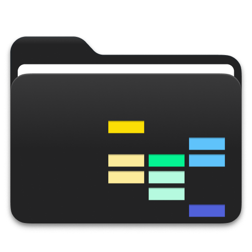
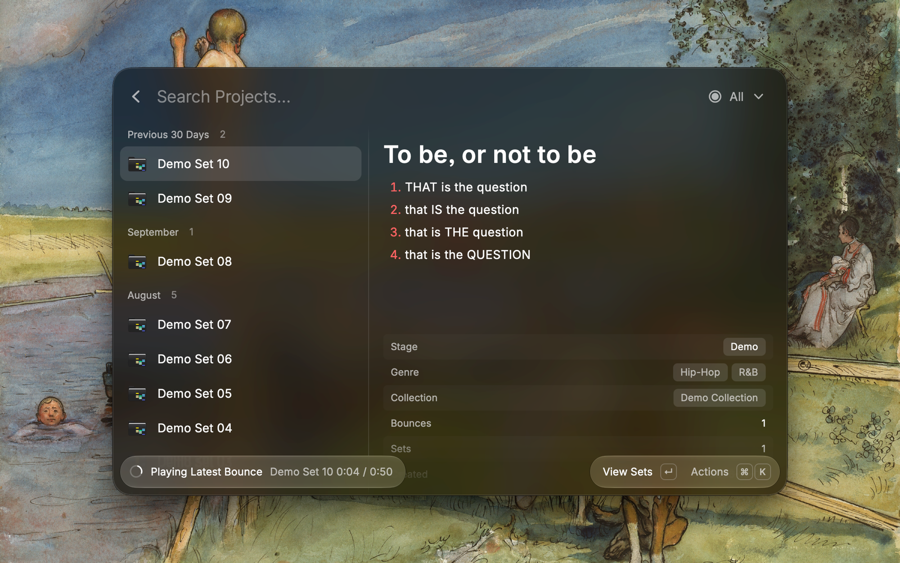
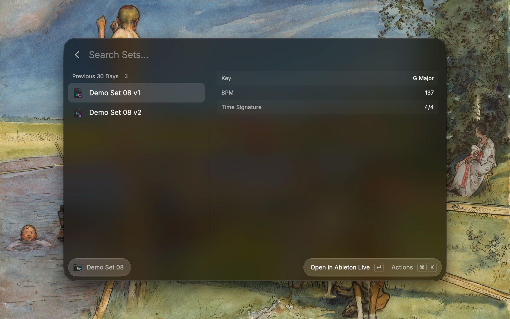
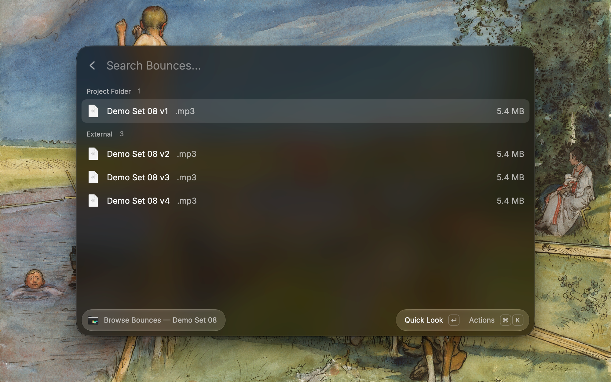
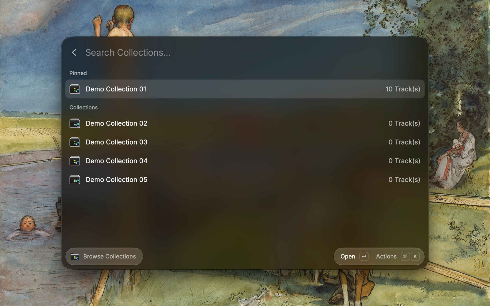
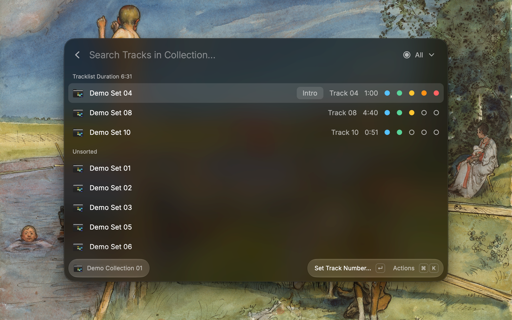
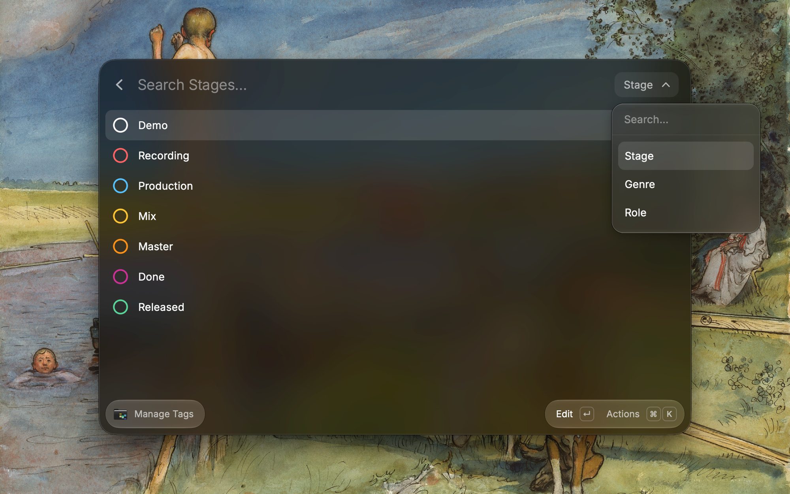

<p align="center">
  
</p>

<h1 align="center">Ableton Project Manager</h1>

<p align="center">
  Browse, organize, and listen to your Ableton Live projects from Raycast — without leaving the keyboard.
</p>

<p align="center">
  English | <a href="README.zh-CN.md">简体中文</a>
</p>

---

Search every project by name, tag it with a stage and genre, keep notes and lyrics next to it, play the latest bounce in one keystroke, and arrange tracks into EPs and albums with an automatic energy scale.

## Install

Coming soon to the Raycast Store. Until then, you can run it from source — see [For developers](#for-developers).

Requires macOS, [Raycast](https://raycast.com), and [Ableton Live](https://www.ableton.com) (to open sets).

## Quick start

1. **Point it at your projects.** Open **Search Projects**. On first launch Raycast asks for your **Projects Folder**: the folder that holds your Ableton Live projects.
2. **Tag what you already have.** Open **Manage Tags**, pick a stage such as Demo, and choose **Assign to Projects** to tag many projects at once. Do the same for genres.
3. **Build a collection.** In Search Projects press `⌃↵` to browse collections, create one for your EP or album, and use **Add Projects** to fill it. Set the track order, and the energy scale appears once the bounces are analyzed.

## Features

### Find

- **Search projects** by name, sort by name, created, or modified, and pin favorites to the top.
- **Filter** the list by stage or genre.
- **Two views**: a compact Overview, or a Detail view with tags, sets, bounces, and your notes alongside.

### Organize

- Give each project a **Stage** (Demo → Recording → Production → … → Released), one or more **Genres**, and **Collections**.
- **Assign to Projects** tags many projects at once from Manage Tags.
- **Renames and deletions in Finder are picked up automatically**, so your tags follow the project.

### Listen

- **Play the latest bounce** of any project with `⌘↵`: pause, resume, seek ±5 s, restart. Playback continues when you switch views **and after you close the Raycast window**. It stops when the track ends, when you press Stop, or when you quit Raycast.
- **Browse bounces** for a project: preview with Quick Look, reveal in Finder, or open in your default app.
- **View sets**: see every `.als` in a project with its **BPM**, **key**, and **time signature**, and open it in Ableton Live.

### Write

- **Notes and lyrics** in Markdown for every project, saved as `Notes.md` / `Lyrics.md` in the project folder, or in a folder of your choice such as an Obsidian vault.
- **Templates** with `{{title}}` and `{{date}}` for new notes and lyrics.
- Edits made in another editor show up right away.

### Collections

- Group projects into **EPs and albums**, order the tracklist, and give each track a **role** (Intro, Single, Interlude, …).
- An **energy scale** for each track, computed from its bounce, helps you shape the running order. See [How energy is calculated](#how-energy-is-calculated).
- **Queue the whole collection** in your music player as an `.m3u` playlist, in track order.

## Screenshots

<table>
  <tr>
    <td align="center" width="33%">
      <a href="metadata/ableton-project-manager-1.png"></a>
      <br /><sub>Search Projects</sub>
    </td>
    <td align="center" width="33%">
      <a href="metadata/ableton-project-manager-2.png"></a>
      <br /><sub>View Sets</sub>
    </td>
    <td align="center" width="33%">
      <a href="metadata/ableton-project-manager-3.png"></a>
      <br /><sub>Browse Bounces</sub>
    </td>
  </tr>
  <tr>
    <td align="center" width="33%">
      <a href="metadata/ableton-project-manager-4.png"></a>
      <br /><sub>Browse Collections</sub>
    </td>
    <td align="center" width="33%">
      <a href="metadata/ableton-project-manager-5.png"></a>
      <br /><sub>Collection</sub>
    </td>
    <td align="center" width="33%">
      <a href="metadata/ableton-project-manager-6.png"></a>
      <br /><sub>Manage Tags</sub>
    </td>
  </tr>
</table>

## Commands

| Command             | Description                                                     |
| ------------------- | --------------------------------------------------------------- |
| **Search Projects** | Search, open, tag, play, and manage your Ableton Live projects. |
| **Manage Tags**     | Create, reorder, and assign Stages and Genres; manage Roles.    |

## Configuration

Set these in Raycast → Extensions → **Ableton Project Manager**:

| Preference             | Required | Description                                                                                                                                                            |
| ---------------------- | -------- | ---------------------------------------------------------------------------------------------------------------------------------------------------------------------- |
| **Projects Folder**    | ✅       | The folder containing your Ableton Live projects.                                                                                                                      |
| **Bounces Subfolder**  | —        | The subfolder inside each project where bounces are saved (e.g. `Bounces`). Leave empty to look directly in each project folder.                                       |
| **Notes Folder**       | —        | The folder where notes are saved as `.md` files (e.g. an Obsidian vault). Leave empty to save `Notes.md` in each project folder.                                       |
| **Lyrics Folder**      | —        | The folder where lyrics are saved as `.md` files. Leave empty to save `Lyrics.md` in each project folder.                                                              |
| **Notes Template**     | —        | Optional `.md` file to use as the starting point for new notes. Supports `{{title}}` and `{{date}}`.                                                                   |
| **Lyrics Template**    | —        | Optional `.md` file to use as the starting point for new lyrics. Supports `{{title}}` and `{{date}}`.                                                                  |
| **Strict Line Breaks** | —        | Off: preserve single line breaks. On: follow standard Markdown line breaks (two trailing spaces or a blank line). Affects the preview only; your files aren’t changed. |
| **Energy: Density**    | —        | How much density (crest factor) affects the energy score. Only the ratio between the three weights matters.                                                            |
| **Energy: Brightness** | —        | How much brightness (spectral centroid) affects the energy score.                                                                                                      |
| **Energy: Movement**   | —        | How much movement (spectral flux) affects the energy score.                                                                                                            |

### How energy is calculated

The latest bounce of each track is analyzed once, and the result is cached until the file changes. Three features are measured:

- **Density**: the crest factor (peak ÷ RMS). A lower crest factor means a denser, more compressed sound, which counts as more energy.
- **Brightness**: the spectral centroid, i.e. where the "center of mass" of the spectrum sits. Brighter, more treble-heavy tracks score higher.
- **Movement**: the spectral flux, i.e. how much the spectrum changes from one moment to the next. Busier tracks score higher.

Within a collection, each feature is scaled from 0 to 1 across its tracks: the lowest value becomes 0 and the highest becomes 1 (inverted for density). The three are then averaged using your weights (Off = 0, Low = 0.5, Normal = 1, High = 2), and the result is shown as 1–5 dots.

- Energy is **relative to the collection**: the same track can show a different number of dots in different collections.
- If a feature can't be measured (e.g. a silent bounce), the remaining features are reweighted. Tracks without a bounce show no energy.
- Set all three weights to **Off** to hide energy entirely.

## Keyboard shortcuts

Every action is in the Action Panel (`⌘K`). The ones you'll use most:

| Action                        | Shortcut                                       |
| ----------------------------- | ---------------------------------------------- |
| Play / pause latest bounce    | `⌘↵`                                           |
| Stop playback                 | `⌘-`                                           |
| Seek backward / forward (±5s) | `⌥←` / `⌥→`                                    |
| Restart track                 | `⌘←`                                           |
| Browse Bounces                | `⌥↵`                                           |
| Browse Collections            | `⌃↵`                                           |
| Back to Search Projects       | `⌃↵` / `⌥↵` (from a collection / bounces view) |
| Edit Info                     | `⌘E`                                           |
| Edit Note                     | `⌘⌥N`                                          |
| Queue collection in player    | `⌘⇧↵`                                          |
| Add projects to a collection  | `⌘N` (in a collection)                         |
| Move track to top / bottom    | `⌘⇧↑` / `⌘⇧↓` (in a collection)                |
| New Live Set                  | `⌘N`                                           |
| Open in Finder                | `⌘⌥O`                                          |

## Your data

**What stays in your folders.** Your projects, sets, and bounces are only changed when you ask: rename, duplicate, or move to Trash. Notes and lyrics are plain Markdown files, either inside each project folder or in the folder you chose.

**What lives in Raycast.** Tags, pins, collections, track order, and roles are stored in the extension's Raycast storage; view preferences and analysis results are cached. Raycast keeps this data per extension, so **uninstalling or reinstalling the extension deletes it**. Raycast's own Export Settings & Data doesn't appear to include it.

**How it follows your projects.**

- **Renaming or deleting a project in Finder** is picked up the next time you open Search Projects; projects are matched by folder creation date. With **Full Disk Access** granted to Raycast, a deletion is confirmed against the Trash. Without it, nothing is changed automatically, and you can run **Clean up Leftovers** to clear data for projects you removed.
- If many projects disappear at once (e.g. an external drive is unplugged), nothing is changed. Switching to a different Projects Folder doesn't trigger this; each folder is tracked separately.
- **Moving a project to the Trash** keeps its tags, track numbers, and roles for **30 days**, and moves its custom-folder notes and lyrics into a `Deleted Projects/` subfolder. Put the project back within that time and everything is restored. A new project that only shares the name doesn't inherit anything.
- **Notes and lyrics in a custom folder** are linked to a project by file name (`<Project Name>.md`). Rename the project inside the extension and the file follows. Characters that are unsafe in file names or special in Obsidian (`/ \ : * ? " < > | # ^ [ ]`) are replaced with full-width look-alikes (e.g. `Beat #3` → `Beat ＃3.md`), so two projects never share a file.

## Known limitations

- **Queue collection** writes a standard `.m3u` playlist and opens it with your default `.m3u` app. Use a player that supports playlists, such as IINA, VLC, or Swinsian; **QuickTime Player doesn't**.
- If you rename a note or lyrics `.md` yourself, the extension can no longer find it.
- If the custom notes or lyrics folder is renamed or moved, the extension shows a warning and **won't write anything** until you choose the folder again in Extension Preferences.

## For developers

Requires Node.js 22+ and npm.

```bash
git clone https://github.com/iyekChen/ableton-project-manager.git
cd ableton-project-manager
npm install
npm run build:player   # build the bundled Swift (AVFoundation) audio player
npm run dev            # run the extension in Raycast (development mode)
```

```bash
npm run lint       # ESLint + Prettier
npm run fix-lint   # auto-fix
npm test           # unit tests (Vitest)
npm run build      # production build
```

### How it works

- **`.als` parsing**: sets are gzipped XML; BPM, key, and time signature are read with `fast-xml-parser` and `saxes`.
- **Audio playback and analysis**: a small Swift AVFoundation binary plays bounces and measures their energy features. It runs as a single detached process, so playback continues across views and after the window closes; the extension controls it through small command and status files. The binary (`assets/audio-player`) is built from [`swift/AudioPlayer.swift`](swift/AudioPlayer.swift) by [`scripts/build-audio-player.sh`](scripts/build-audio-player.sh) as a universal arm64 + x86_64 executable. CI checks that the committed binary matches the source.
- **Storage**: tags, pins, and per-project metadata are in Raycast LocalStorage; view preferences are in Raycast Cache; notes and lyrics are Markdown files.

## License

MIT © iyek
