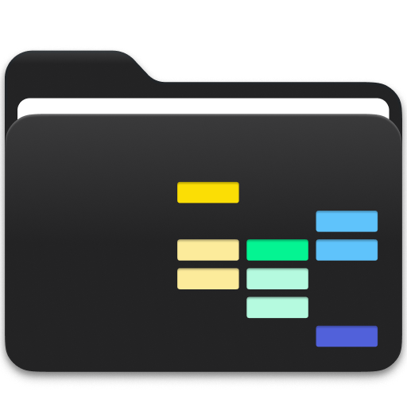

<p align="center">
  
</p>

<h1 align="center">Ableton Project Manager</h1>

<p align="center">
  Browse, tag and listen to your Ableton Live projects and bounces, and organize them into collections on your Mac.
</p>

<p align="center">
  English | <a href="https://github.com/iyekChen/ableton-project-manager/blob/main/README.zh-CN.md">简体中文</a>
</p>

## ✨ What it does

- **[Browse, tag, and open your projects](#-projects)**.
- **[Find projects](#-search)** by name, tag, created date, key, BPM, and more.
- **[Gather your bounces](#-bounces)** from project folders, a shared export folder, or anywhere else.
- **[Listen to your bounces](#playback)** without digging through Finder.
- **[Plan the tracklist](#-collections)** for an EP or album, give tracks roles, and compare each track's energy.
- **[Keep notes and lyrics](#-notes--lyrics)** as Markdown files, in each project or in a folder such as an Obsidian vault.
- **[Start new Live Sets](#-live-templates)** from your templates.

See also: [Configuration](#-configuration) · [Data & files](#-data--files) · [Known limitations](#-known-limitations) · [For developers](#-for-developers)

## 🚀 Quick start

| Command             | Use it to                                                         |
| ------------------- | ----------------------------------------------------------------- |
| **Search Projects** | Browse, play, and organize your projects and collections          |
| **Search Bounces**  | Find any bounce across all your projects                          |
| **Manage Tags**     | Edit your stages, genres, and track roles, and tag projects       |
| **Export Data**     | Back up your tags, collections, and other extension data to a file |
| **Import Data**     | Restore that data from an exported file                           |

Most of the time you'll use Search Projects. To get it ready:

### ① Set your Projects Folder

- Open Search Projects. On first launch, Raycast asks you to select the folder containing your Ableton Live projects.
- Each folder directly inside it that contains at least one `.als` file counts as a project. Folders nested deeper aren't found.

### ② Tell it where your bounces are

- In Extension Preferences, set Bounces Subfolder to the subfolder inside each project where you save bounces (e.g. `Bounces`), or leave it empty if they're saved directly in each project folder.
- If you also export bounces from all your projects into one folder, set it as the Shared Bounces Folder. Files there are matched to projects by name; see [Shared Bounces Folder](#shared-bounces-folder).
- To include bounces stored anywhere else, select a project in Search Projects and use Manage External Bounce.

### ③ Tag your projects

- In Manage Tags, select a stage (Demo, Mix, Released…) or genre and use Assign to Projects to tag several projects at once. You can also give stages, genres, and roles search aliases there (e.g. `dnb` for Drum & Bass).
- To tag a single project, use Edit Info in Search Projects.

### ④ Try it

- Select a project in Search Projects: Enter shows its Sets, ⌘O opens the latest one, and ⌘↵ plays its latest bounce. Press ⌘K to see every other action.

**You're all set.** Everything below covers each feature in detail, for when you want to dig deeper.

## 📁 Projects

Search Projects lists every project in your Projects Folder, with its stage and how many Sets and bounces it has. Pinned projects stay at the top. The rest can be grouped by created or modified date and sorted by date or name.

### Opening Sets

- **View Sets** (Enter) lists a project's Sets. Open one in Ableton Live, or rename, duplicate, or move it to the Trash. Renaming asks you to close the Set in Live first.
- **Open Latest Set** (⌘O) opens the project's most recently modified Set.

### Detail view

Show Detail (⌘⇧T) adds a side panel with the project's note, stage, genres, collections, number of bounces and Sets, the latest Set's name, key, and BPM, and the created and modified dates. Show Lyrics (⌘⌥⇧T) switches the panel to the lyrics; see [Notes & lyrics](#-notes--lyrics).

### Playback

There are two ways to listen: the built-in player plays a project's latest bounce in the background, and Quick Look previews any bounce.

- **Play Latest Bounce** (⌘↵) plays the project's latest bounce. Press it again to pause or resume.
- While something is playing, you can also use Stop Playback (⌘-), Backward and Forward (⌥← and ⌥→, 5 seconds), and Restart Track (⌘←).
- Playback keeps going when you close the Raycast window, and stops when Raycast quits.
- **Browse Bounces** (⌥↵) lists all of the project's bounces. Press Enter to preview any of them with Quick Look; see [Bounces](#-bounces).
- **Copy Latest Bounce** copies the audio file itself, so you can paste it into a message or another app.

### Managing projects

- **Edit Info** changes a project's name, stage, genres, and collections. To tag several projects at once, use Assign to Projects in Manage Tags; see [Quick start](#-tag-your-projects). Renaming asks you to close the project in Live first, then renames its folder; tags, track numbers, roles, notes, and lyrics move with it.
- **Duplicate Project** copies the whole project folder under a new name (`Song copy` by default). The copy starts without tags, collections, notes, or lyrics.
- **Pin** keeps a project at the top of the list. Pinned projects can be reordered with Move Up and Move Down.
- **Move to Trash** moves the whole project folder to the Trash. Its data is kept for 30 days in case you put it back; see [Project tracking](#project-tracking).
- Open the project in Finder, or copy its name or path.

## 🔍 Search

Search Projects matches what you type against each project's name, stage, genres, collections, and created year and month, as well as the key of its latest Set. Use the dropdown next to the search bar to show only one stage, genre, or year.

### Combined search

Start with `#` to combine filters; the space after it is optional (`# am` or `#am`). Every word must match, in any order, and the dropdown filter still applies. Typing `#` on its own shows a short reminder, with Open README to come back here.

| Field          | What to type                                                                                                                | Examples                                |
| -------------- | --------------------------------------------------------------------------------------------------------------------------- | --------------------------------------- |
| Name           | Any part of the project name                                                                                                | `# demo`                                |
| Stage, genre   | The name or one of its aliases                                                                                              | `# mix`, `# rnb`, `# hiphop`            |
| Collection     | Any part of the collection name                                                                                             | `# collab`, `# album`                   |
| Created date   | A year, or an English month name or abbreviation                                                                            | `# 2025`, `# jun`                       |
| Key            | Root and scale with no space: `m`, `min`, or `minor`; `maj` or `major`; or another scale name. Write ♯ as `#` and ♭ as `b` | `# am`, `# c#m`, `# ebmaj`, `# ddorian` |
| BPM            | A tempo, with or without `bpm`, or a range                                                                                  | `# 120`, `# 90-100`                     |
| Time signature | Numerator and denominator                                                                                                   | `# 6/8`                                 |

For example, `# rnb 2025 am 120-128` finds R&B projects created in 2025, in A minor, at 120–128 BPM.

Things that are easy to miss:

- **Words match anywhere.** Each word can match a different field, and text matches any part of it: `# pop` finds the genre Pop and also a project called Popcorn. `# 2025` finds projects created in 2025 and projects with 2025 in their name.
- **Spelling is forgiving.** Case, spaces, punctuation, accents, and full-width characters are ignored, so `hiphop` finds Hip-Hop and `cafe` finds Café. `&` can be typed as `n` or `and`, so `rnb` and `randb` find R&B.
- **Short numbers are tempos.** Numbers with up to three digits are always read as BPM, so `# album 01` looks for a tempo of 1 instead of a collection called Album 01. Search by the words in the name instead.
- **Half and double tempo count.** `# 140` also finds projects at 70 and 280 BPM, and tempos are rounded, so 139.6 counts as 140. A range includes both ends and can be written either way round (`100-90`).
- **Keys and time signatures match whole.** `# cm` finds C minor only, not C major. A root on its own (`a`, `eb`) isn't a key search, and `# a minor` is read as two separate words. Both spellings of a black key work: `c#m` and `dbm` find the same projects. `6/8` doesn't match `6/4`.
- **They come from the latest Set.** Key, BPM, and time signature are read from each project's most recently modified Set in the background, then cached. Until a project's Set has been read, it doesn't match these words.
- **Without `#`, search is fuzzy.** It still covers names, tags, collections, created dates, and keys, but not BPM or time signature.

## 🎧 Bounces

### Where bounces come from

A project's bounces are collected from:

- its Bounces Subfolder, or the project folder itself if the subfolder is empty;
- the [Shared Bounces Folder](#shared-bounces-folder), for files whose names match the project;
- external folders and files added with Manage External Bounce. Sources that can't be reached (e.g. an unplugged drive) are kept and shown as unavailable until you remove them. If a linked file is renamed in place or moved into one of your bounce folders, it's re-linked automatically when there's a single match.

A file reached through more than one source counts once. The most recently modified audio file (WAV, AIFF, MP3, M4A, or FLAC) is the latest bounce: it's the one that's played, copied, queued, and used for energy analysis. Browse Bounces (⌥↵) lists all of a project's bounces.

### Shared Bounces Folder

- A file belongs to a project when its name starts with the project name, followed by a space, `-`, `_`, `.`, or nothing else. `Song.wav`, `Song v2.wav`, and `Song-master.wav` all belong to `Song`; `Songbird.wav` doesn't. Case doesn't matter.
- If a file matches more than one project, the longest name wins: `Demo Package v2.wav` belongs to `Demo Package`, not `Demo`.
- **Bounce Aliases:** in Manage External Bounce, add other names a project's files start with (e.g. `SC` for `Summer Children`). An alias can't be another project's name or alias. This field only appears when a Shared Bounces Folder is set.
- **Renamed projects:** after a rename, the old name keeps matching only files created before the rename, so a new project with that name doesn't take them. Deselect a name under Previous Names in Manage External Bounce to stop matching it.
- **Not This Project:** in Browse Bounces, sends a wrongly matched file back to Unmatched Bounces.

Assigning bounces never moves or renames your files.

### Unmatched bounces

When a Shared Bounces Folder is set, files in it that don't belong to any project are listed in Unmatched Bounces (⌘⇧B in Search Projects) and marked in [Search Bounces](#search-bounces). The first time you open Search Projects after setting or changing the folder, the extension offers to review any unmatched files it finds.

Use Assign to Project to give a file to a project:

- **All Files Starting With…:** adds the beginning of the file name as a bounce alias, so this file and future ones go to that project.
- **This File Only:** adds just this file as an external bounce.

### Search Bounces

The Search Bounces command lists the bounces of every project in one place. A file that belongs to several projects appears once, next to all of their names.

- Search by file name or project name. Type `unmatched` to find files that don't belong to any project; they're marked with an orange question mark.
- Press Enter to preview a bounce with Quick Look. Browse Project Bounces (⌥↵) opens the bounces of the project the file belongs to, and Assign to Project gives an unmatched file to a project.
- Bounces are grouped by created date. Group by Source to see whether each file comes from a project folder, the shared folder, an external source, or is unmatched.

## 💿 Collections

A collection is a group of projects, such as an EP, an album, or a set of collabs. A project can be in any number of collections, and it has a separate track number and role in each one.

### Building a collection

1. In Search Projects, use Browse Collections (⌃↵), then Create.
2. Open the collection and use Add Projects…. You can also add a project to collections from its Edit Info.
3. New tracks wait in Unsorted. Press Enter to Set Track Number…, or use Add to Tracklist to give a track the next free number.

In Browse Collections, you can rename, pin, or delete collections. Deleting a collection doesn't delete its projects.

### Working with the tracklist

- **Tracklist** lists numbered tracks in order, with each track's role, number, duration, and energy. Its header shows the total duration. **Unsorted** lists the other tracks alphabetically.
- Reorder with Swap Up and Swap Down, or Move to Top and Move to Bottom. If two tracks share a number, both are marked with a warning icon.
- **Roles:** open Edit Info from inside a collection to give a track a role, such as Intro or Interlude. Edit the list of roles in Manage Tags. Remove from Tracklist also clears the track's role.
- Use the dropdown to show only one stage or genre. The Detail view shows each track's note, stage, duration, role, BPM, key, time signature, and energy.
- Play any track's latest bounce with ⌘↵, as in Search Projects.
- **Queue Collection in Player** (⌘⇧↵) opens the latest bounce of every track as an `.m3u` playlist in your default player: the Tracklist first, then Unsorted. Tracks without a bounce are skipped. See [Known limitations](#-known-limitations) for player support.
- **Remove from Collection** removes a track from the collection, along with its number and role there. The project itself isn't affected.
- Back to Search Projects (⌃↵) returns to your project list from anywhere in Browse Collections.

### How energy is calculated

Energy helps you sequence a tracklist by comparing how dense, bright, and busy each track sounds next to the others in the collection. It isn't a rating of how good a track is.

When you open a collection, the latest bounce of every track is analyzed in the background; the header shows progress until it finishes. Results are cached and reused until the file changes. Three features are measured on a mono mix-down of the whole file:

- **Density:** crest factor (peak ÷ RMS). A lower crest factor means a denser, more compressed sound, so it scores higher.
- **Brightness:** the power-weighted spectral centroid. Brighter, more treble-heavy tracks score higher.
- **Movement:** spectral flux, how much the spectrum changes from one moment to the next. Busier tracks score higher. Flux is measured on a level-normalized spectrum, so loudness alone doesn't raise it.

Each feature is then scaled from 0 to 1 across the tracks in the collection's Tracklist: the lowest value becomes 0 and the highest becomes 1 (density is inverted). If every track has the same value, that feature counts as 0.5. The score is the weighted average of the three, using Off = 0, Low = 0.5, Normal = 1, High = 2, and is shown as 1–5 dots colored from cool to warm.

- Energy is relative to the collection. The same track can score differently in another collection.
- Only tracks in the Tracklist get a score. Unsorted tracks don't, and they don't affect anyone else's score.
- If a feature can't be measured (e.g. a silent bounce), the remaining weights are used. Tracks without a bounce show empty dots.
- Set all three weights to Off in Extension Preferences to hide energy entirely.

## 📝 Notes & lyrics

Each project can have a note and a lyrics file. By default they're saved as `Notes.md` and `Lyrics.md` in the project folder; set a Notes Folder or Lyrics Folder to keep them elsewhere. In Search Projects, the Detail panel (⌘⇧T) shows the note, and ⌘⌥⇧T switches between notes and lyrics. Edit them in Raycast with Edit Note (⌘⌥N) and Edit Lyrics (⌘⌥L), or in your Markdown app with Open Note (⌘⇧N) and Open Lyrics (⌘⇧L). Changes made in other apps show up right away.

### Note templates

A template is applied when a note or lyrics file is created, or when the existing file is empty. This covers Open Note, Open Lyrics, and the first save in Edit Note or Edit Lyrics.

| Placeholder | Becomes                      | Default format |
| ----------- | ---------------------------- | -------------- |
| `{{title}}` | The project name             | —              |
| `{{date}}`  | The date the file is created | `YYYY-MM-DD`   |
| `{{time}}`  | The time the file is created | `HH:mm`        |

`{{date}}` and `{{time}}` accept a custom format, as in Obsidian: `{{date:YYYY/MM/DD}}`, `{{date:MMMM D, YYYY}}`, `{{time:HH.mm}}`. Supported tokens are `YYYY` `YY` `MMMM` `MMM` `MM` `M` `DD` `D` `dddd` `ddd` `HH` `mm`; text in `[brackets]` is kept as-is.

YAML frontmatter is hidden in the Raycast preview and kept intact when you edit in Raycast, so a template like this works well with Obsidian:

```yaml
---
title: "{{title}}"
date: "{{date}}"
time: "{{time}}"
tags:
  - ableton_live
  - project-note
---
```

### File names

- In a custom Notes Folder or Lyrics Folder, files are named `<Project Name>.md`. If notes and lyrics share the same folder, they are named `<Project Name> @Notes.md` and `<Project Name> @Lyrics.md`.
- Renaming a project in the extension or in Finder also renames its note and lyrics files.
- Characters that are unsafe in file names or special in Obsidian (`/ \ : * ? " < > | # ^ [ ]`) are replaced with full-width look-alikes, so `Beat #3` becomes `Beat ＃3.md`. If two project names would still end up with the same file, the extension won't read or write it until you rename one of them.

## 🎹 Live templates

In Search Projects, New Live Set from Template (⌘⌥⌃N) lists the `.als` files in your Templates Folder, which defaults to `~/Music/Ableton/User Library/Templates`. Templates at the top level form one group, and each subfolder forms its own group; folders nested deeper aren't read. New Live Set (⌘N) just opens Ableton Live, or brings it to the front if it's already running.

Choosing a template opens it in Ableton Live. Saving asks for a new name, so the template itself stays unchanged. You can also rename a template or move it to the Trash from the list.

## 🔧 Configuration

| Preference                | Description                                                                                                                                                            |
| ------------------------- | ---------------------------------------------------------------------------------------------------------------------------------------------------------------------- |
| **Projects Folder**       | The folder containing your Ableton Live projects.                                                                                                                      |
| **Shared Bounces Folder** | One folder for bounces from all your projects. Files are matched to projects by name; see [Shared Bounces Folder](#shared-bounces-folder).                             |
| **Bounces Subfolder**     | The subfolder inside each project where bounces are saved (e.g. `Bounces`). Leave empty to look directly in each project folder.                                       |
| **Templates Folder**      | The folder that holds your Live templates. Leave empty to use `~/Music/Ableton/User Library/Templates`; see [Live templates](#-live-templates).                         |
| **Notes Folder**          | The folder where notes are saved as `.md` files (e.g. an Obsidian vault). Leave empty to save `Notes.md` in each project folder.                                       |
| **Lyrics Folder**         | The folder where lyrics are saved as `.md` files. Leave empty to save `Lyrics.md` in each project folder.                                                              |
| **Notes Template**        | Optional `.md` file used as the starting point for new notes; see [Note templates](#note-templates).                                                                   |
| **Lyrics Template**       | Optional `.md` file used as the starting point for new lyrics; see [Note templates](#note-templates).                                                                  |
| **Strict Line Breaks**    | Off: preserve single line breaks. On: follow standard Markdown line breaks (two trailing spaces or a blank line). Affects the preview only; your files aren't changed. |
| **Energy: Density**       | How much density (crest factor) affects the energy score; see [How energy is calculated](#how-energy-is-calculated). Only the ratio between the three weights matters. |
| **Energy: Brightness**    | How much brightness (spectral centroid) affects the energy score.                                                                                                      |
| **Energy: Movement**      | How much movement (spectral flux) affects the energy score.                                                                                                            |

## 📦 Data & files

### What changes on disk

Project files change only when you ask: renaming a project in Edit Info, renaming or duplicating a Set, renaming a bounce, duplicating a project, renaming a template, or moving something to Trash. Renaming a project or Set asks you to close it in Ableton Live first. Notes and lyrics are written only when you edit or open them, and are renamed or archived along with their project as described below.

### Storage

The extension stores its own data in Raycast:

- **LocalStorage:** stages, genres, roles, and collections; each project's tags, collections, pin, external bounce sources, and Shared Bounces Folder matching (bounce aliases, previous names, and files marked Not This Project); track numbers and roles; pinned collections; grouping choices in Browse Bounces and Search Bounces; the project list used to detect Finder changes; records of deleted projects; and cached Set metadata and bounce analysis.
- **Cache:** view mode, sort, and grouping choices in Search Projects; bounce counts; and the last project and bounce lists, so Search Projects and Search Bounces show your list right away while they check for changes.

Raycast keeps this data per extension. Uninstalling the extension deletes it. Your projects, notes, and lyrics are ordinary files and aren't affected.

### Export & import

- **Export Data** saves your tags and tag lists, collections, pins, track numbers, roles, bounce sources and aliases, and recently deleted projects to a `.json` file in a folder you choose. Extension preferences, notes, and lyrics aren't included.
- **Import Data** restores every project that existed at export time to the file's state, and keeps projects added since then. If a newer project's track number collides with one from the file, that project moves to Unsorted. Projects renamed since the export are matched by their folder.
- If any of your current data would change, Import Data first shows what will change and saves a backup of your current data next to the imported file.
- A file can only be imported by the extension that exported it.

### Project tracking

While Search Projects is open, it watches your Projects Folder and reloads when projects are added, renamed, removed, or put back. Changes made while it was closed are applied the next time you open it.

- **Renames:** a project renamed in Finder is recognized by its folder's creation time and file system ID (inode), so its tags, track numbers, roles, and notes move with it. Duplicating a folder and deleting the original is not mistaken for a rename.
- **Deletions:** if Raycast has Full Disk Access and the folder is found in the Trash, its data is archived and cleared, just like Move to Trash. Without Full Disk Access, nothing is cleared automatically. A toast lets you open the Full Disk Access settings, and Clean Up Leftovers (in the Action Panel when there is something to clean up) clears data for projects you removed.
- **Missing drive:** if every project disappears, or more than half of them (and more than three) disappear at once, nothing is changed. A toast suggests checking the drive or the Projects Folder setting.
- **Separate folders:** each Projects Folder keeps its own project list, so switching folders doesn't look like mass deletion.
- **Trash recovery:** moving a project to Trash keeps its tags, collections, track numbers, and roles for 30 days. Notes and lyrics stored in custom folders move into a `Deleted Projects/` subfolder. Put the folder back from the Trash within that time and everything is restored. Collections deleted in the meantime are skipped, and nothing overwrites data you've added since.
- **New projects:** a new folder that happens to share a deleted project's name doesn't inherit its data.

## 🚧 Known limitations

- **Queue Collection in Player:** use a player that supports `.m3u` playlists, such as IINA, VLC, or Swinsian. QuickTime Player doesn't.
- **Renaming files externally:** if you rename a note or lyrics `.md` file yourself, the extension can no longer find it.
- **Moving custom folders:** if a custom notes or lyrics folder is renamed or moved, the extension shows a warning and won't write anything until you choose the folder again in Extension Preferences.
- **Same-named projects across libraries:** projects are identified by folder name, so if you switch to a different Projects Folder that contains a project with the same name, it shows the same tags and collections.
- **Changing note and lyrics folders:** if notes and lyrics start or stop sharing the same custom folder, their file names switch between `<Project Name>.md` and `<Project Name> @Notes.md` / `@Lyrics.md`. Existing files aren't renamed, so rename them yourself to keep them linked.
- **Shared Bounces Folder:** only files directly inside the folder are read; subfolders aren't.

## 💻 For developers

Requires Node.js 22+ and npm.

```bash
git clone https://github.com/iyekChen/ableton-project-manager.git
cd ableton-project-manager
npm install
npm run dev        # Run the extension in Raycast development mode
```

Checks and builds:

```bash
npm run lint       # ESLint + Prettier
npm run fix-lint   # Auto-fix lint and formatting issues
npm test           # Run unit tests with Vitest
npm run build      # Build the production extension
```

The audio player binary (`assets/audio-player`) is committed, so you don't need to build it to run the extension. If you change [`swift/AudioPlayer.swift`](https://github.com/iyekChen/ableton-project-manager/blob/main/swift/AudioPlayer.swift), rebuild it and commit both the binary and `swift/AudioPlayer.swift.sha256`:

```bash
npm run build:player   # Requires Xcode Command Line Tools (swiftc, lipo)
```

CI runs lint and tests, checks that the player was rebuilt after the last change to its Swift source, then builds the player and the extension.

### How it works

- **Live Sets:** `.als` files are gzipped XML. Each Set is streamed through gunzip and parsed with [`saxes`](https://github.com/lddubeau/saxes) to read tempo, time signature, and scale.
- **Playback:** a small Swift binary built on AVFoundation plays bounces as a detached process, so playback survives view changes and closing the Raycast window. The extension controls it through command and status files in its support folder. The player stops on its own when Raycast quits.
- **Analysis:** the same binary has an `analyze` mode that streams the file in chunks and computes RMS, peak, spectral centroid, and spectral flux using a 2048-point FFT, without loading the whole file into memory.
- **Build:** [`scripts/build-audio-player.sh`](https://github.com/iyekChen/ableton-project-manager/blob/main/scripts/build-audio-player.sh) compiles a universal arm64 + x86_64 binary targeting macOS 11 and records the source hash that CI checks.
